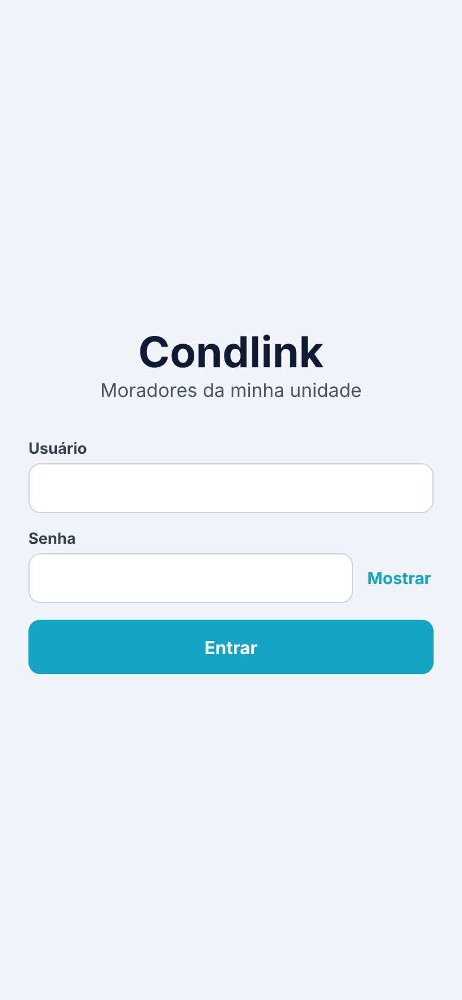
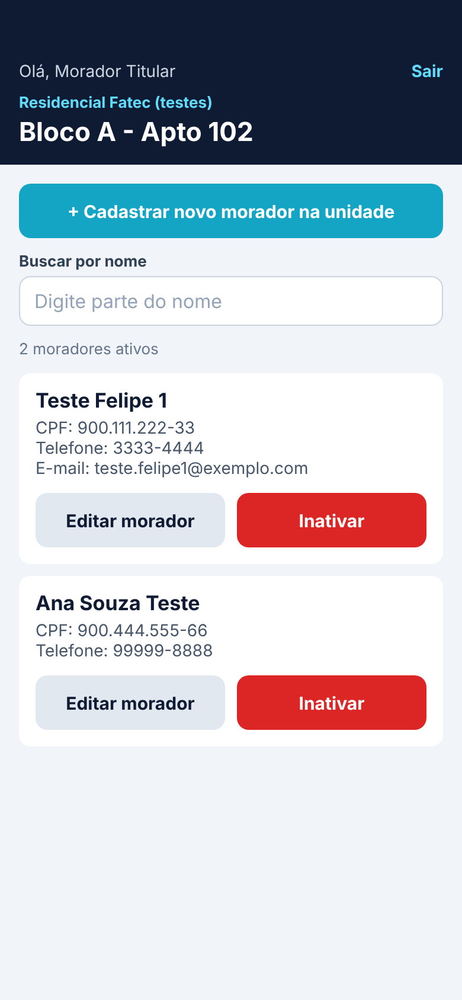
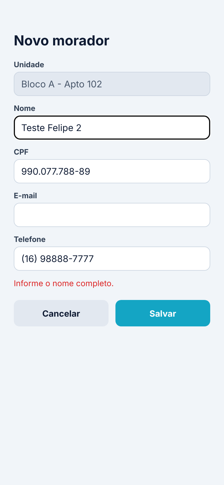
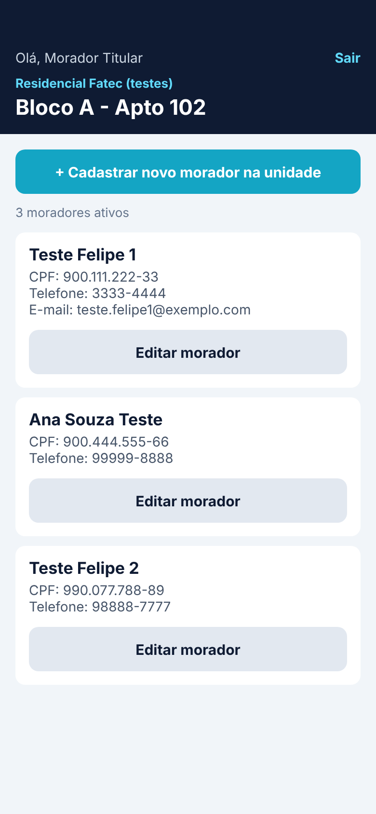
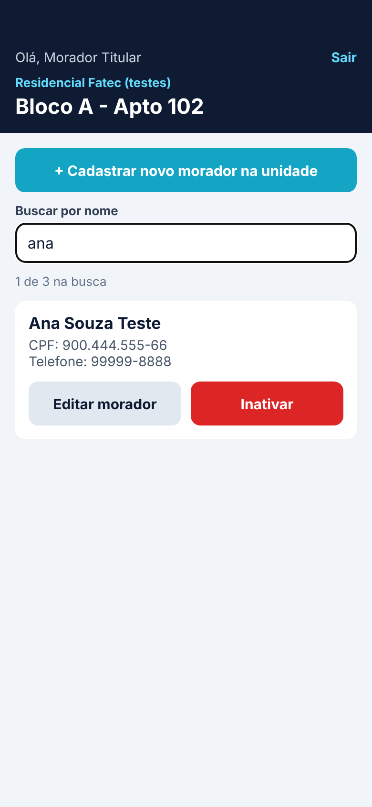
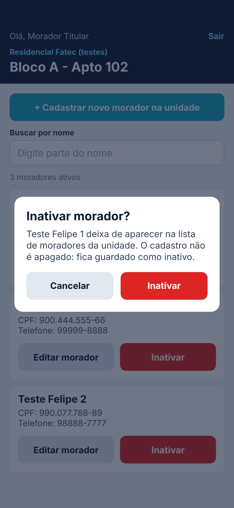

# CRUD Condlink: moradores da minha unidade

App de morador feito em React Native com Expo, no laboratório bônus **crud-condlink** da disciplina **Desenvolvimento para Dispositivos Móveis** (prof. Arnaldo, FATEC Araraquara, 2º semestre de 2026).

O morador faz login com JWT na API real da Condlink, a sessão fica guardada no cofre do celular, a unidade dele aparece fixa no topo, e ali ele lista, cadastra, edita e inativa as outras pessoas que moram com ele.

É um sub-projeto do app do semestre, a **Vitrine** ([Felpz016/vitrine-mobile](https://github.com/Felpz016/vitrine-mobile)), em repositório separado porque o roteiro pede um projeto novo.

<p>
  
  
  
  
  
  
</p>

<sub>As imagens foram tiradas com dados de mentira, sem chamar a API de verdade.</sub>

## O que ele faz

| Operação | Método HTTP | Cloud Function | Onde no app |
| --- | --- | --- | --- |
| Login | `POST` | `app-login` | `src/api/login.ts` |
| Minha unidade | `GET` | `app-pessoa-me` | `src/api/unidade.ts` |
| Listar moradores | `GET` | `app-residente-manage` | `src/api/listarMoradores.ts` |
| Cadastrar | `POST` | `app-residente-manage` | `src/api/cadastrarMorador.ts` |
| Editar | `PUT` | `app-residente-manage` | `src/api/editarMorador.ts` |
| Inativar | `DELETE` | `app-residente-manage` | `src/api/inativarMorador.ts` |

## Stack

| Item | Versão |
| --- | --- |
| Expo | SDK 58 (o mesmo do Expo Go do celular) |
| React Native | 0.88 |
| React | 19.3 (`react-dom` na mesma versão) |
| TypeScript | estrito |
| Sessão | `expo-secure-store` (Keychain no iOS, Keystore no Android) |
| Testes | `node:test`, o test runner do próprio Node, sem biblioteca extra |
| Web | `react-native-web` + `@expo/metro-runtime` |

Como na calculadora, **não há** Expo Router nem NativeWind: modelo `blank-typescript`, uma tela só e estilos com `StyleSheet`.

## Estrutura

| Caminho | O que é |
| --- | --- |
| `App.tsx` | Raiz: restaura a sessão do cofre, busca a unidade e decide qual tela mostrar |
| `src/config.ts` | Endereço da API (do `.env`) e as rotas |
| `src/tema.ts` | Todas as cores do app num lugar só |
| `src/servicos/http.ts` | `requisicao`: a única função que faz `fetch` (token, JSON, erros) |
| `src/servicos/jwt.ts` | Lê o conteúdo do token e diz se ele venceu |
| `src/servicos/armazenamento.ts` | Guarda, lê e apaga a sessão no SecureStore |
| `src/api/*.ts` | Uma função por operação da API (cada uma tem um `curl` equivalente) |
| `src/telas/TelaLogin.tsx` | Login |
| `src/telas/TelaMoradores.tsx` | Lista com busca, cadastro, edição e inativação |
| `src/componentes/` | `Botao`, `Campo`, `CabecalhoUnidade`, `CartaoMorador`, `FormularioMorador`, `ConfirmarInativacao` |
| `src/utils/formatar.ts` | CPF e telefone: formatar, separar e máscaras |
| `src/utils/validar.ts` | Validação do formulário do morador |
| `src/utils/filtrar.ts` | Busca por nome, sem chamar a API de novo |
| `tests/` | Testes (`npm test`) |
| `curl/` | Corpos JSON e comandos para testar a API pelo terminal |
| `public/simulador.html`, `iniciar.cmd` | Simulador de celular no navegador |
| `docs/` | Explicação do laboratório e o material de estudo |

## Como rodar

> Usuário e senha de teste: o professor entrega na aula. **Não** escreva em arquivo que vá para o GitHub.

### Com simulador de celular no navegador (Windows)

Dê dois cliques em `iniciar.cmd` (ou rode `.\iniciar.cmd` no PowerShell). Na primeira vez ele cria o `.env`, instala as dependências, liga o Expo e abre http://localhost:8081/simulador.html.

O QR code continua no terminal para abrir no Expo Go. **Prefira o celular para testar o login**: no navegador, a API pode recusar o pedido por CORS (regra de segurança dos navegadores), e o app mostra "Sem conexão com a Condlink".

### Manualmente

No PowerShell, na pasta dos projetos (ao lado da `vitrine-mobile`, não dentro dela):

```powershell
git clone https://github.com/Felpz016/crud-condlink.git
cd crud-condlink
Copy-Item .env.example .env
npm install
npx expo start -c     # QR code para o Expo Go
```

Em um segundo terminal:

```powershell
npm run check   # TypeScript (tsc --noEmit): precisa terminar sem mensagens
npm test        # testes de formatar, validar, jwt, unidade, API (com fetch falso) e filtrar
```

## Documentação

- [Como o app funciona, fase por fase, e o que mudou em relação ao roteiro](docs/crud-condlink.md)
- [Material de estudo para a apresentação](docs/estudo-apresentacao.md)
- [Testar a API pelo terminal (curl)](curl/README.md)
